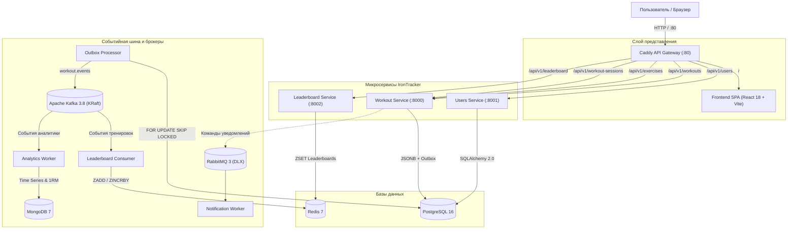

# IronTracker 🏋️‍♂️⚡

[]()
[]()
[]()
[]()
[]()
[]()

**IronTracker** — высокопроизводительная микросервисная платформа для любителей и профессионалов тяжелой атлетики, пауэрлифтинга и силового многоборья. Платформа спроектирована по стандартам Enterprise-архитектуры: паттерн **Transactional Outbox**, строгая изоляция данных (**IDOR Protection**), рейтинги в реальном времени (**Redis ZSET**), потоковая аналитика (**Kafka + MongoDB Time Series**) и адаптивный веб-интерфейс с интерактивным режимом тренировки в реальном времени (**Live Workout Mode**).

---

## 📌 Оглавление
- [Архитектура платформы](#-архитектура-платформы)
- [Микросервисы и инфраструктура](#-микросервисы-и-инфраструктура)
- [Функциональные возможности](#-функциональные-возможности)
- [Быстрый старт (Zero Host Clutter)](#-быстрый-старт-zero-host-clutter)
- [Демо-данные (Seed Data)](#-генерация-демо-данных-seed-data)
- [Локальная разработка](#-локальная-разработка)
- [Тестирование и Quality Gate](#-тестирование-и-quality-gate)
- [Структура монорепозитория](#-структура-монорепозитория)
- [Мультиагентный процесс разработки (Harness)](#-мультиагентный-процесс-разработки-harness)

---

## 🏛 Архитектура платформы

Архитектура системы построена по принципам распределенных микросервисов с единой точкой входа (**API Gateway**) и четким разделением потоков данных (CQRS/Event-Driven):



---

## 🧩 Микросервисы и инфраструктура

| Модуль / Сервис | Стек технологий | Назначение и ответственность |
|:---|:---|:---|
| **Caddy Gateway** | Caddy 2 (Alpine) | Единая точка входа (`:80`), обратный прокси, маршрутизация, отдача статики SPA, сокрытие портов бэкенда от внешнего доступа. |
| **Frontend** | React 18+, TypeScript (strict), Tailwind CSS, Zustand, Vite, Recharts | Клиентское веб-приложение: адаптивная тема Iron Dark, интерактивный Live Workout, графики 1RM, лидерборд, мультиязычность RU/EN. |
| **Users Service** | FastAPI, PostgreSQL 16, JWT HS256, bcrypt | Регистрация, аутентификация, профили атлетов, выдача JWT токенов, строгая валидация прав доступа (IDOR Protection). |
| **Workout Service** | FastAPI, PostgreSQL 16 (JSONB), Alembic | Учет тренировок и подходов, многоупражненческие сессии, каталог упражнений, транзакционная надежность через **Transactional Outbox**. |
| **Outbox Processor** | Python asyncio, aiokafka | Фоновый воркер-ретранслятор: гарантированная доставка (`At-least-once`) событий из таблицы `outbox` в Kafka без Dual Write. |
| **Leaderboard Service** | FastAPI, Redis 7 (`redis.asyncio`) | Вычисление рейтингов атлетов по суммарному тоннажу в реальном времени через Redis `Sorted Sets (ZSET)`. |
| **Analytics Service** | Async Worker, Kafka 3.8, MongoDB 7 (`motor`) | Фоновый анализ спортивных результатов, агрегация временных рядов (Time Series) и расчет одноповторного максимума (1RM). |
| **Notification Service**| Async Worker, RabbitMQ 3 (`aio-pika`) | Адресная отправка уведомлений о личных рекордах с механизмом повторных попыток через Dead Letter Exchange (DLX). |
| **Shared Contracts** | Python Pydantic v2 | Общая библиотека типов, схем событий и команд для исключения дрейфа форматов данных между сервисами. |

---

## 🚀 Функциональные возможности

### 1. Интерактивный режим тренировки (Live Workout Mode)
- **Пошаговая фиксация подходов в 1 клик:** быстрые степперы веса (±2.5 кг) и повторений (±1 повт.), автоподстановка предыдущего сета, мгновенное дублирование подхода.
- **RPE и разминка:** выбор коэффициента усилия RPE (7, 8, 9, 10) и мгновенный переключатель `is_warmup` (разминочные сеты автоматически исключаются из тоннажа).
- **Wall-clock Rest Timer:** ненавязчивый таймер отдыха между сетами (пресеты 60с, 90с, 120с, 180с и секундомер), опирающийся на системное время `Date.now()`. Таймер не отстает и не сбивается при блокировке экрана смартфона или сворачивании браузера.
- **Изолированное автосохранение черновика:** сессия непрерывно сохраняется в `localStorage` по ключу `irontracker_live_workout_draft_${userId}`. При случайной перезагрузке страницы или разрядке устройства тренировка восстанавливается через баннер в 1 клик.
- **Экран триумфа (Celebration Summary):** после завершения сессия атомарно уходит на сервер с красивой итоговой статистикой тоннажа, подходов и длительности.

### 2. Конструктор многоупражненческих сессий и каталог упражнений
- Поддержка тренировок, включающих несколько упражнений в рамках одной сессии.
- Пользовательский каталог с фильтрацией по мышечным группам (грудь, спина, ноги, плечи, руки, кор) и инвентарю (штанга, гантели, тренажер, собственный вес).
- Добавление кастомных упражнений с привязкой к атлету и защитой от IDOR.

### 3. Лидерборд и спортивная аналитика
- Динамический рейтинг атлетов по рабочему тоннажу на базе структур Redis `ZSET`.
- Графики прогрессии 1RM (одноповторного максимума) на базе формул Эпли и Бжицки с интерактивным масштабированием.
- Карточки ключевых показателей: суммарный тоннаж, количество тренировок, персональные рекорды.

### 4. Мультиязычность (i18n)
- Полная локализация интерфейса на русский (**RU**) и английский (**EN**) языки с автоматическим сохранением выбранной локали в браузере.

---

## 🐳 Быстрый старт (Zero Host Clutter)

Согласно стандартам проекта, вся инфраструктура и сервисы запускаются **исключительно в изолированных Docker-контейнерах**, исключая засорение хост-системы.

### 1. Клонирование репозитория
```bash
git clone https://github.com/kiokroel/IronTracker.git
cd IronTracker
```

### 2. Настройка переменных окружения
Скопируйте базовый файл переменных:
```bash
cp .env.example .env
```
*(Параметры по умолчанию уже оптимизированы для локального развертывания)*.

### 3. Сборка и запуск платформы
Запустите все сервисы в одну команду:
```bash
docker compose up -d --build
```

### 4. Доступные адреса:
После запуска сервисы доступны через единый шлюз Caddy:
- 🌐 **Веб-интерфейс IronTracker:** [http://localhost](http://localhost) (порт `80`)
- 🩺 **Health Check API Gateway:** [http://localhost/health](http://localhost/health)
- 📚 **Каталог упражнений API:** [http://localhost/api/v1/exercises](http://localhost/api/v1/exercises)
- 🐰 **RabbitMQ Management UI:** [http://localhost:15672](http://localhost:15672) *(логин: `irontracker`, пароль: `irontracker_rabbit_secret`)*
- 📊 **Kafka UI (опционально):** `docker compose --profile tools up -d` -> [http://localhost:8085](http://localhost:8085)

---

## 🧪 Генерация демо-данных (Seed Data)

Для комфортного тестирования системы доступен скрипт наполнения базы демонстрационными атлетами, тренировками и записями лидерборда:

```bash
# Выполнить генерацию демо-данных через запущенный контейнер:
docker compose exec workout-service python -m workout_service.src.scripts.seed_demo_data
```

Скрипт создаст:
- Тестового пользователя: email `lifter@irontracker.io`, пароль `SecurePassword123!`
- Соревнующихся ботов в лидерборде: `BenchKing`, `DeadliftMonster`, `SquatQueen`
- Базовый пул тренировочных сессий и заполненный Redis ZSET рейтинг.

---

## 💻 Локальная разработка

Если вам требуется вносить изменения в код компонентов локально:

### Разработка Frontend
```bash
cd frontend
npm install
npm run dev
# Сервер разработки запустится на http://localhost:5173
```

### Проверка типов и линтинг Frontend
```bash
cd frontend
npm run lint    # Проверка типов через tsc --noEmit
npm test        # Модульные тесты через Vitest
npm run build   # Сборка продакшн-бандла Vite
```

### Разработка Backend
Для запуска Python-скриптов и тестов локально создайте виртуальное окружение:
```bash
python -m venv .venv
# Активация:
# Windows: .venv\Scripts\activate
# Linux/macOS: source .venv/bin/activate

pip install -e shared/contracts
pip install -e ".[dev]"
```

---

## 🛡 Тестирование и Quality Gate

В проекте IronTracker действует строгий стандарт качества (**Zero Vanity Testing**): запрещены фиктивные тесты, текстовый парсинг исходников и тривиальные ассерты.

### Запуск тестов бэкенда (pytest)
```bash
pytest tests/ -v
```

### Статический анализ кода и форматирование (Ruff)
```bash
ruff check .
ruff format --check .
```

### Статическая проверка типов Python (Mypy Strict)
```bash
mypy --strict workout_service/ leaderboard_service/ users_service/ shared/
```

### Статический аудит безопасности (SAST Bandit)
```bash
bandit -r workout_service/ leaderboard_service/ analytics_service/ notification_service/ users_service/ shared/ tests/ -ll
```

---

## 📂 Структура монорепозитория

Каждый микросервис изолирован в собственной директории со строгой **слоистой модульной архитектурой**:

```text
irontracker/
├── Caddyfile                         # Конфигурация единого шлюза Caddy Gateway
├── docker-compose.yml                # Полная оркестрация 14 контейнеров
├── pyproject.toml                    # Корневая конфигурация линтеров (ruff, mypy, pytest)
│
├── frontend/                         # Клиентское приложение (React 18+, Vite, TS)
│   ├── src/
│   │   ├── api/                      # Типизированные клиенты API (Axios + Bearer JWT)
│   │   ├── components/               # Модульные UI компоненты (workouts, layout, ui)
│   │   ├── locales/                  # Словари локализации (ru.ts, en.ts)
│   │   ├── pages/                    # Страницы (WorkoutsPage, LeaderboardPage, AuthPage)
│   │   ├── store/                    # Zustand сторы (useAuthStore, useLiveWorkoutStore)
│   │   ├── types/                    # TypeScript интерфейсы и DTO
│   │   └── utils/                    # Спортивные формулы 1RM, таймеры, форматирование
│   └── package.json
│
├── workout_service/                  # Сервис тренировок и сессий
│   ├── src/
│   │   ├── core/                     # config (pydantic-settings), database (asyncpg)
│   │   ├── models/                   # SQLAlchemy 2.0 ORM (workout.py, outbox.py, exercise.py)
│   │   ├── schemas/                  # Pydantic v2 DTO с Discriminated Unions
│   │   ├── repositories/             # BaseRepository и кастомный доступ к данным
│   │   ├── controllers/              # Бизнес-логика и Transactional Outbox
│   │   ├── routes/                   # Роутеры FastAPI (/api/v1/workouts, /exercises)
│   │   └── services/                 # Фоновый Outbox Processor воркер
│   └── Dockerfile
│
├── users_service/                    # Сервис аутентификации и профилей (JWT, bcrypt)
├── leaderboard_service/              # Сервис рейтингов в реальном времени (FastAPI + Redis)
├── analytics_service/                # Сервис макро-аналитики (Async Worker + Kafka + MongoDB)
├── notification_service/             # Сервис уведомлений (Async Worker + RabbitMQ DLX)
├── shared/contracts/                 # Централизованные межсервисные контракты Pydantic v2
└── tests/                            # Интеграционные и сквозные E2E тесты платформы
```

---

## 🤖 Мультиагентный процесс разработки (Harness)

Разработка платформы IronTracker автоматизирована по специализированной мультиагентной схеме под управлением навыка `iron-orchestrator`:

1. **Разработчик (`iron-developer` / `iron-frontend`):** проектирует схемы, пишет асинхронную бизнес-логику или React-компоненты, покрывает код юнит-тестами.
2. **Тестировщик (`iron-tester` на модели `flash`):** автоматически проводит полный цикл консольных проверок (`tsc`, `vitest`, `pytest`, `ruff`, `bandit`, `pip-audit`).
3. **Архитектурный цензор и ИБ (`iron-critic` на модели `pro`):** проводит глубокий семантический аудит архитектуры, проверяет отсутствие Dual Write, утечек данных, IDOR, race conditions и выносит вердикт `VERDICT: APPROVED`.
4. **Git Flow & Notion:** каждая задача связывается с канбан-доской Notion, веткой `feat/*` и автоматически сливается через Pull Request после одобрения пользователем.

---

## 📄 Лицензия

Проект распространяется под лицензией MIT. Подробности в файле [LICENSE](LICENSE).
